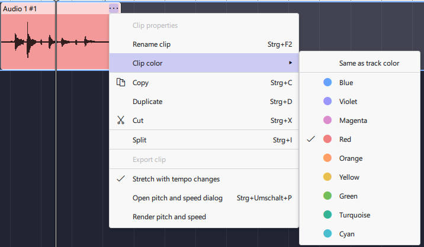
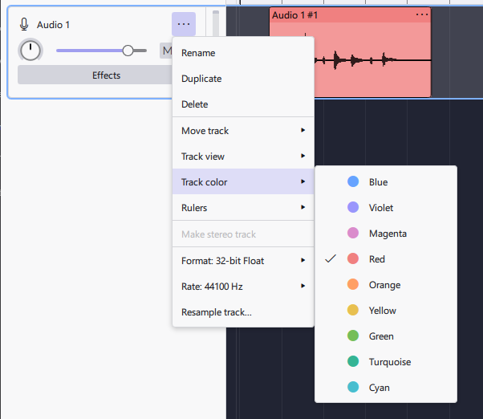

import Callout from "../../components/manual/Callout.astro";

<Callout type="info">
  This feature is only available if you have **colorful clips** enabled in
  **Preferences → Appearance → Clip style**.
</Callout>

## Changing color per clip

To change clip color, click on the 3-dot menu on the top right of the clip and select **Clip color**. You then are given the choice between several colors.

## Changing color for an entire track

To change the color for all clips on a track, click on the 3-dot menu on the track header and select **Track color**. You then are given the choice between several colors.

<Callout type="info">
  Changing track color only changes the color for clips which follow the track
  color. If you have changed the clip color for individual clips, they won't
  change color if you change track color.
</Callout>
