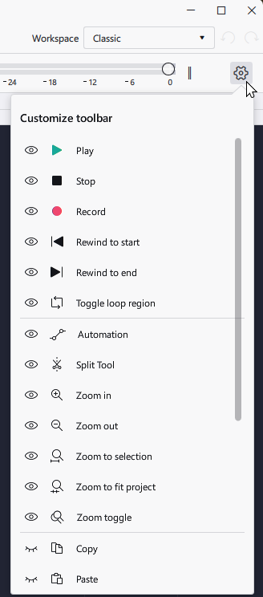
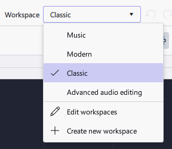
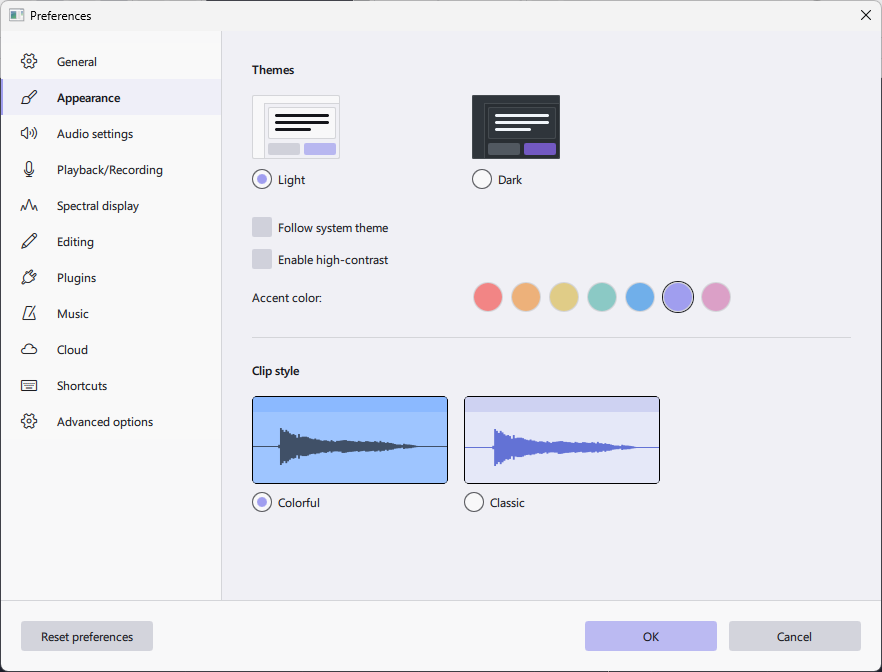

import Callout from "../../components/manual/Callout.astro";

## Workspaces

### Turning on and off features

You can turn on and off individual features in Audacity's toolbar using the cog icon on the right. Doing so will show or hide certain UI elements in the toolbar.

### Moving, docking and floating parts of the UI

Toolbars and panels can be moved by grabbing and dragging them at the top (like an app window), or the ⠿ 6-dot grabber of the element.

### Workspace presets

You can switch between different presets using the Workspace dropdown in the top right corner of Audacity.

<Callout type="info">
  All UI modifications you make are automatically saved to the workspace you're
  currently in.
</Callout>

## Themes

Audacity's theme, accent color and clip style can be changed in **Preferences → Appearance**.

### Custom themes

It is possible to further customize Audacity's look using the config files located in the Audacity install folder's `/bin/config`. Note though that changes to themes here will be overwritten every time Audacity is updated.
