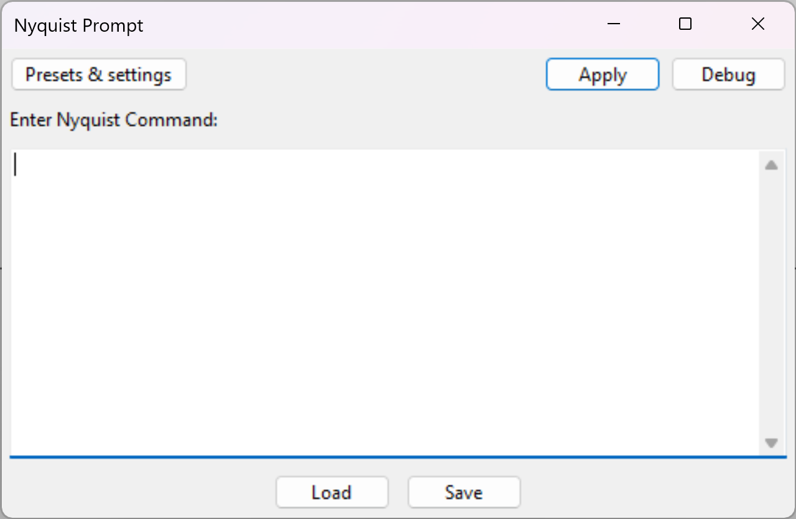
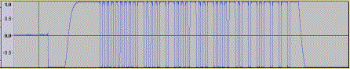
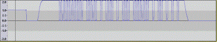
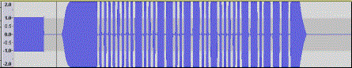

import Callout from "../../../../../../../components/manual/Callout.astro";

## Setting up

The Audacity Nyquist prompt appears in Audacity's "Tools" menu.&#x20;

<Callout type="info">
For testing generate-type commands in Nyquist, you can use the [Generate Prompt plugin ](/plugins/nyquist-plugins/generator-plugins/generator-utilities/#nyquist-generate-prompt)instead.
</Callout>

### Load a Sound File

Sound files are imported into Audacity via: **File > Import > Audio** or the shortcut `CTRL + SHIFT + I`.

If you have no pre-existing sound files to work with, you can create your own mono or stereo tracks via the Audacity "Generate" menu.

## The Nyquist Prompt

Select the track(s) and click **Tools > Nyquist Prompt**.

The Nyquist Prompt appears like this:



*<p>Nyquist prompt example</p>*

### Hello, world!

Simply enter the code below and press Apply to receive a "hello world" prompt:

```lisp
(print "hello world")
```

The programming language used above is Lisp. The Nyquist prompt automatically assumes you're using Lisp if the first character is an `(`. If it isn't, the prompt assumes you are writing SAL, which is more similar to C-like syntax. If you prefer SAL, a "hello world" program looks like this:

```text
return "hello world"
```

### The Nyquist Debugger

The prompt also comes with a debug button. It shows you various warnings and non-fatal errors after the program finished. For example, if you forget the quotation marks around <mark style="color:red;">`"`</mark>`hello world`<mark style="color:red;">`"`</mark>, just hitting apply will just do nothing, whereas hitting debug will tell you where you went wrong:

```lisp
;Lisp input: (print hello world)
error: unbound variable - HELLO
if continued: try evaluating symbol again
1> 

;Sal input: retun hello world
>>> parse error: Syntax error.
>>> in NIL, line 1, col 14.

return hello world 
             ^
```

### Basic Nyquist Commands

The current Nyquist manual is here: [Nyquist Reference Manual](https://www.cs.cmu.edu/\~rbd/doc/nyquist/).

A useful index of Nyquist commands is here: [Nyquist Language reference](https://www.cs.cmu.edu/\~rbd/doc/nyquist/indx.html)

Audacity uses the **\*TRACK\*** variable to reference the current audio file/selection. Thus, you can use basic commands such as **mult** or **sum** with **\*track\*** and the Nyquist prompt will replace the file/selection with the result (or as Audacity calls it, "returned audio").&#x20;

<Callout type="info">
Note: Prior to version 4 syntax, the vaiable `S` was used instead of `*TRACK*`. You may encounter this in some old plugins or old documentation. The old syntax is obsolete and should not be used in new code
</Callout>

### Simple Examples

<Callout type="info">
Note: These examples are focused upon using Audacity to manipulate digital signals (clearly Audacity is better suited to audio, but features such as Nyquist can open many other uses). For those interested, the signal used is an [infra red (IR) sample](http://en.wikipedia.org/wiki/Consumer\_IR) from a remote control.
</Callout>

#### **Applying a DC offset to a signal**



*<p>Original signal before command</p>*

Type the following into the Nyquist Prompt (using LISP syntax): `(sum *track* 1)`\
``Or type the following equivalent SAL command: `return *track* + 1`



*<p>Resulting signal</p>*

The whole signal has now moved up to above zero.

#### **Modulating with a carrier frequency**

To multiply a signal with a generated carrier signal, you can use the following commands:&#x20;

```lisp
(mult *track* (hzosc 19000))  ; Lisp
return *track* * hzosc(19000) ; Sal
```

The (hzosc 19000) produces 19kHz sine wave carrier.

```lisp
(mult *track* (osc-pulse 19000 0)) ; Lisp
return *track* * osc-pulse(19000, 0) ; Sal
```

The `(osc-pulse 19000 0)` produces 19kHz square wave carrier (note the 0 is the bias or 50/50 duty cycle, -1 to 1 = 0%-100% pulse-width ). Applying the 19kHz square wave carrier obtains this result.



*<p>resulting waveform</p>*

The top and bottoms of the signal can then be clipped using the Hard Limiter option from the effects menu (0dB limit and Wet level 1) if required.

The above examples show how you can use the many Nyquist commands to perform basic signal processing without using scripts.

<Callout type="info">
Note: Unfortunately, this isn't the end of the road for this sample; it is near, but the curved "head/tail" of the signal causes a problem for the digital signal being produced \[and it was also upside-down, too...]. This will hopefully form the basis of some more complex examples, since I shall need to use Nyquist to:&#x20;

1. Find the zero crossing points&#x20;
2. Then only apply the carrier frequency to those regions above zero. Or find another suitable command...
</Callout>
