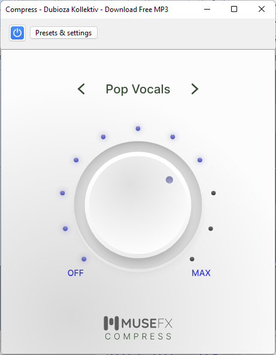
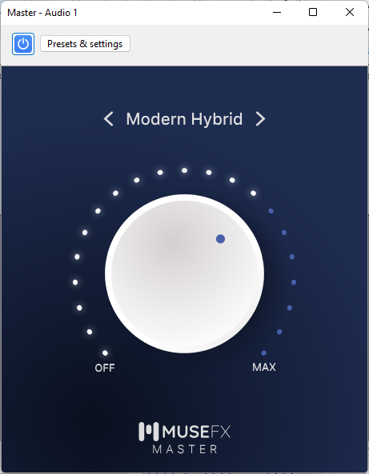
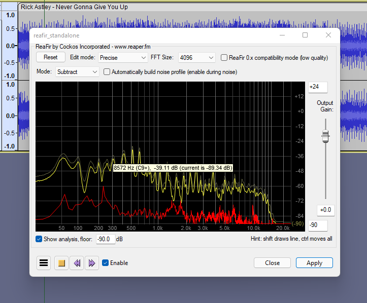
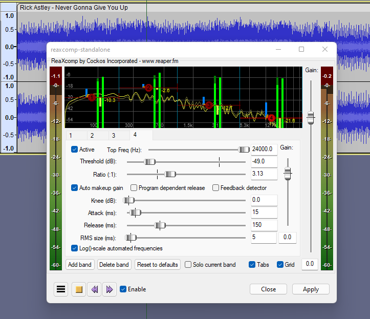

import { museHubURL } from "../../../../assets/data/museHubLinks";

## Muse FX Compress

An easy to use compressor effect. Part of the [Muse FX](/manual/plugins/realtime-effects/plugin-suites/#muse-fx) pack.

Details

See the pack for installation instructions.

## MuseFX Master

An easy to use mastering plugin. Part of the [Muse FX](/manual/plugins/realtime-effects/plugin-suites/#muse-fx) pack.

Details

See the pack for installation instructions.

## ReaFIR

A multi-purpose dynamics processor, can be used for EQ, compressor, gate and noise reduction purposes. Part of ReaPlugs.

[Download page](https://www.reaper.fm/reaplugs)

Details

Copyright (C) 2006-2016, Cockos Incorporated VST PlugIn Technology by Steinberg Media Technologies GmbH

Information from the vendor:

* FFT based dynamics processor
* Supports FFT sizes of 128-32768
* Useful in/out frequency response display
* Supports defining response curves both using any number of points, or freehand mouse
* EQ - can be used as a linear phase mastering EQ, or as a super-effective surgical EQ
* Compressor - can compress at a fixed ratio with a per-band threshold
* Gate - can gate with per-band threshold
* Subtract - can build noise profiles and subtract noise from the signal

## MCompressor

A powerful compressor with custom processing shape, part of the [MFreeFXBundle](/manual/plugins/realtime-effects/plugin-suites/#mfreefxbundle) pack

Details

MCompressor provides refined compression. It features an adjustable compression shape, giving you the power to create dynamic sound effects, and a range of up-sampling options for a crystal clear sound.

* Advanced GUI
* Compare multiple settings: A to H Switching and A to D Morphing.
* Unique visualisation engine with classic meters and time graphs
* MIDI controllers with MIDI learn
* M/S, single channel, up to 8 channelds surround and up to 64 channels ambisonics processing
* Extremely fast, optimized for newest AVX2 and AVX512 capable processors
* Supports VST, VST3, AU and AAX interfaces on Windows and macOS

See the [pack ](/manual/plugins/realtime-effects/plugin-suites/#mfreefxbundle)for installation instructions.

## ReaXcomp

A multi-band compressor effect, part of ReaPlugs.

[Download page](https://www.reaper.fm/reaplugs)

Details

Copyright (C) 2006-2016, Cockos Incorporated VST PlugIn Technology by Steinberg Media Technologies GmbH

Information From the vendor:

* Unlimited band compressor
* Great metering per band
* Fantastic sounding filters
* Solo current band mode
* Tons of controls per band (ratio, threshold, knee, attack, release, makeup, program dependent release, feedback detector, RMS size)
* Adjusting bands in graph is easy (modifiers to change ratio, gain, etc)

## See also

* Nyquist [Dynamics Processing](/manual/plugins/nyquist-plugins/effect-plugins/dynamics-processing/) effects
* Nyquist [Amplify, Mix and Pan Effects](/manual/plugins/nyquist-plugins/effect-plugins/amplify-mix-and-pan-effects/)

<a href={museHubURL("/category/plugin", "plugins-dynamics")} class="button primary">Browse plugins on MuseHub</a>
