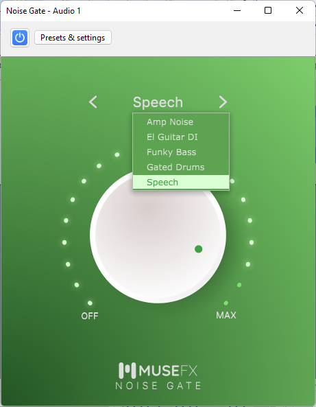
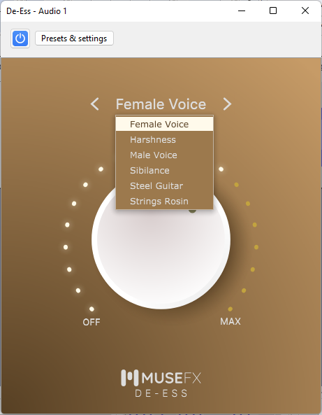
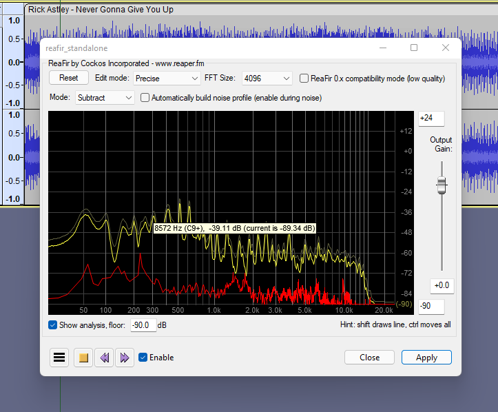
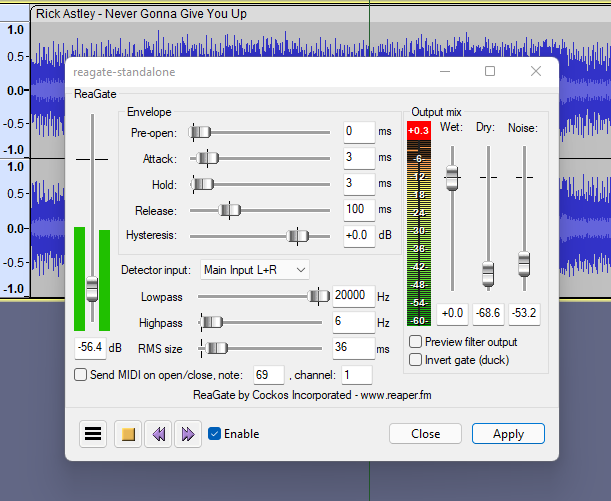

import Callout from "../../../../components/manual/Callout.astro";
import { museHubURL } from "../../../../assets/data/museHubLinks";

## MuseFX Noise Gate

A noise gate. Part of the [Muse FX](/manual/plugins/realtime-effects/plugin-suites/#muse-fx) pack.

Details

See the pack for installation instructions.

A noise gate keeps noise in quiet parts out while not affecting the audio you want at all.

## MuseFX De-Ess

An easy to use de-esser. Part of the [Muse FX](/manual/plugins/realtime-effects/plugin-suites/#muse-fx) pack.

Details

See the pack for installation instructions.

Has presets for female and male voices, harshness, sibilance, steel guitar and strings rosin.

## ReaFIR

A multi-purpose dynamics processor, can be used for EQ, compressor, gate and noise reduction purposes. Part of ReaPlugs.

[Download page](https://www.reaper.fm/reaplugs)

<Callout type="info">
Hint: ReaFIR in Subtract mode can be used to remove noise.
</Callout>

Details

Copyright (C) 2006-2016, Cockos Incorporated VST PlugIn Technology by Steinberg Media Technologies GmbH

Information from the vendor:

* FFT based dynamics processor
* Supports FFT sizes of 128-32768
* Useful in/out frequency response display
* Supports defining response curves both using any number of points, or freehand mouse
* EQ - can be used as a linear phase mastering EQ, or as a super-effective surgical EQ
* Compressor - can compress at a fixed ratio with a per-band threshold
* Gate - can gate with per-band threshold
* Subtract - can build noise profiles and subtract noise from the signal

## ReaGate

A noise gate effect, part of ReaPlugs.

[Download page](https://www.reaper.fm/reaplugs)

Details

Copyright (C) 2006-2016, Cockos Incorporated VST PlugIn Technology by Steinberg Media Technologies GmbH

Information From the vendor:

* Ultra-configurable gate
* Sidechain filters, sidechain input
* Lookahead for pre-open
* Hold control
* Hysteresis control
* Variable RMS size
* Can send MIDI events on gate open/close
* Wet/dry mix, noise mix (can add noise when gate is open)

## RNNoise suppression for voice

Removes most sounds that aren't speech.

<Callout type="warning">
This plugin only works with a 48000Hz sample rate. You can change the project sample rate in Audio Setup -> Audio Settings.
</Callout>

[Download page](https://github.com/werman/noise-suppression-for-voice/releases)

## NVIDIA Broadcast

A virtual device that sits between your microphone and Audacity and other programs which allows you to use an AI denoiser.

<Callout type="warning">
**Caution:** NVIDIA Broadcast only works on Windows machines with a NVIDIA RTX GPU.

Further, it only works on spoken word content; musical content is treated as noise and filtered out.
</Callout>

[Download page](https://www.nvidia.com/en-gb/geforce/broadcasting/broadcast-app/)

Details

Copyright © 2022 NVIDIA Corporation

Requires NVIDIA GeForce RTX 2060, Quadro RTX 3000, TITAN RTX or higher

Full setup guide: [https://www.nvidia.com/en-gb/geforce/guides/broadcast-app-setup-guide/](https://www.nvidia.com/en-gb/geforce/guides/broadcast-app-setup-guide/)

Technically, NVIDIA Broadcast isn't a plugin but a virtual device. You will find it in Audacity's audio settings as an input. It does not show up in the Plugin Manager.

## See also

* [Dynamics Processing](/manual/plugins/realtime-effects/dynamics-processing/) - Dynamics processors can often be used for noise reduction purposes

<a href={museHubURL("/category/plugin/voice-and-podcasting", "plugins-noise-repair")} class="button primary">Browse voice and podcasting plugins</a>
