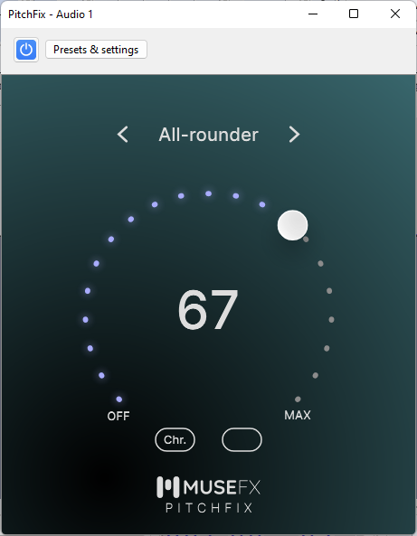

import { museHubURL } from "../../../../assets/data/museHubLinks";

## MuseFX PitchFix

An easy to use pitch correction/snapping/autotune effect. Part of the [Muse FX](/plugins/realtime-effects/plugin-suites/#muse-fx) pack.

Details

See the pack for installation instructions.

Has modes optimized for male/female voices and more, and can snap to major, minor and even more rare scales (eg Lydian).

## MAutoPitch

Automatic vocal tuning effect, part of the [MFreeFXBundle](/plugins/realtime-effects/plugin-suites/#mfreefxbundle) pack

Details

MAutoPitch is a simple but great sounding automatic tuning and pitch correction plugin designed for vocals and other monophonic instruments. Besides making the audio more in-tune, MAutoPitch also provides creative features such as formant shift and stereo-expansion.

* Advanced GUI
* Compare multiple settings: A to H Switching and A to D Morphing.
* Unique visualisation engine with classic meters and time graphs
* MIDI controllers with MIDI learn
* Automatic gain compensation (AGC)
* M/S, single channel, up to 8 channels surround and up to 64 channels ambisonics processing
* Extremely fast, optimized for newest AVX2 and AVX512 capable processors
* Supports VST, VST3, AU and AAX interfaces on Windows and macOS

See the [pack ](/plugins/realtime-effects/plugin-suites/#mfreefxbundle)for installation instructions.

## See also

* Nyquist [Time, Pitch and Tempo](/plugins/nyquist-plugins/effect-plugins/time-pitch-and-tempo/) effects

<a href={museHubURL("/category/plugin", "plugins-pitch-tempo")} class="button primary">Browse plugins on MuseHub</a>
