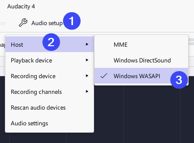
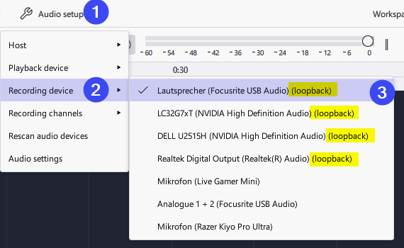
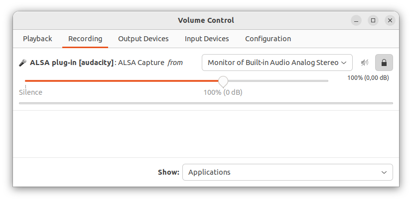
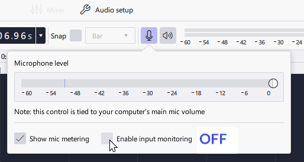

import Tabs from "../../components/manual/Tabs/Tabs.astro";
import Tab from "../../components/manual/Tabs/Tab.astro";
import Pitfalls from "../../components/manual/Pitfalls.astro";
import Callout from "../../components/manual/Callout.astro";

## 1. Select the loopback device

<Tabs>
<Tab label="Windows">

1. Click **Audio setup** and set **Host** to **Windows WASAPI**.

   

2. Under **Recording device**, select the output you listen through. It is marked **(loopback)** after its name.

   

<Callout type="info">
  Some sound cards also offer a loopback option called _Stereo Mix_, _What you
  hear_ or similar. That records your desktop audio too.
</Callout>

</Tab>
<Tab label="macOS">

<Callout type="info">
  macOS has no built-in way to record what it is playing. BlackHole, a free
  and open source virtual audio driver, adds one. It works on Apple silicon
  and Intel Macs.
</Callout>

#### BlackHole

1. Install **BlackHole 2ch**. Close Audacity and any other audio applications first. Download the installer from [existential.audio/blackhole](https://existential.audio/blackhole/) and restart when it asks, or install it with Homebrew:

   ```
   brew install blackhole-2ch
   ```

2. Open **Audio MIDI Setup**, found in `/Applications/Utilities`.
3. Click **+** in the bottom-left corner and choose **Create Multi-Output Device**.
4. In the panel on the right, tick your usual output (your speakers or headphones) and **BlackHole 2ch**. Sound sent to this device plays through your speakers and into BlackHole at the same time.
5. Make sure your speakers or headphones are the **first** device in that list, not BlackHole: the first device keeps time for the others. If BlackHole is listed first, untick it and tick it again to move it down. Check that **Drift Correction** is ticked for BlackHole; macOS usually ticks it for you.
6. Right-click the new device in the list on the left and choose **Use This Device For Sound Output**. Without this step the recording works, but you hear nothing while it runs.
7. In Audacity, click **Audio setup** and set **Recording device** to **BlackHole 2ch**. If BlackHole isn't in the list, choose **Rescan audio devices** in the same menu, or quit and reopen Audacity: it only lists devices that existed when it last looked. If macOS asks whether Audacity may use the microphone, allow it: BlackHole counts as one.

<Callout type="info">
  macOS cannot change the volume of a multi-output device, so the volume keys
  do nothing while it is selected. Adjust the volume in the application you
  are recording from, and switch the output back to your speakers afterwards
  in **System Settings → Sound**.
</Callout>

</Tab>
<Tab label="Linux">

When using PulseAudio or PipeWire, the default on Ubuntu, Fedora, Linux Mint and most other distributions:

1. Install **PulseAudio Volume Control** (`pavucontrol`) from your distribution's package manager. It works with PipeWire too.
2. Click **Audio setup** and set **Host** to **ALSA** and **Recording device** to **pulse**. If your system uses Pulse by default, the device may be called **default** instead.
3. Click the microphone button in the toolbar to open the **Microphone level** flyout. Its meter shows the incoming level as soon as the flyout is open.
4. Open **PulseAudio Volume Control** and go to the **Recording** tab.
5. In the **Capture from** dropdown next to Audacity, select the **Monitor of** entry for the device the application you want to record plays through.

   

6. Start playback in the application you want to record.
7. Drag the volume slider on the **Recording** tab until Audacity's meter peaks below 0 dB. Around −6 dB is a good level.

</Tab>
</Tabs>

## 2. Check if everything is set up correctly

Recording the desktop audio records everything the computer plays: notification pings, games, and Audacity itself (for example, other tracks in the timeline if you are overdubbing). Unless you want those sounds in the recording, turn them off first.

<Pitfalls>

**Don't use input monitoring** when recording desktop audio. In the **Microphone level** flyout, make sure **Enable input monitoring** is off, or the recording feeds back into itself.



</Pitfalls>

## 3. Record

Start playback so that audio is flowing, then press the record button.

<Callout type="tip" title="Start playback first">
  On Windows, WASAPI can record a silent stream, but it cannot record when
  there is no stream at all. Press play in the application before you press
  record in Audacity.
</Callout>
